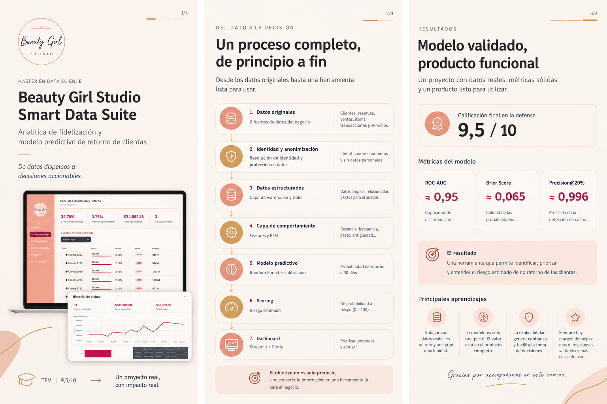
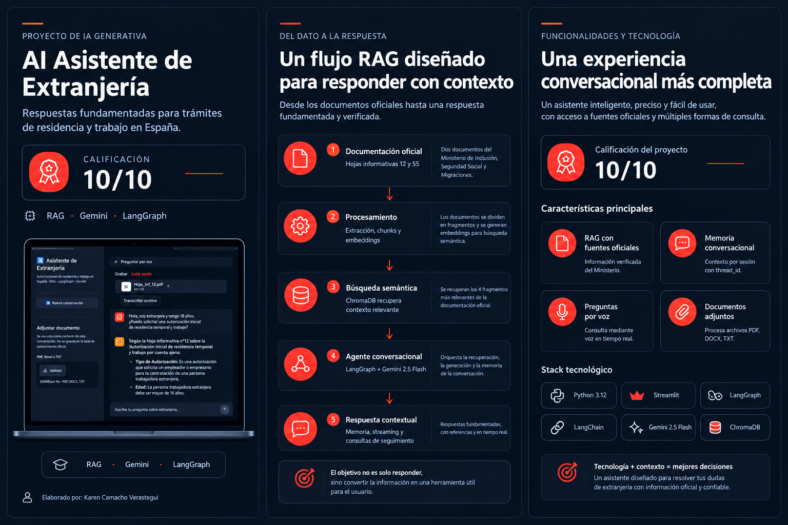
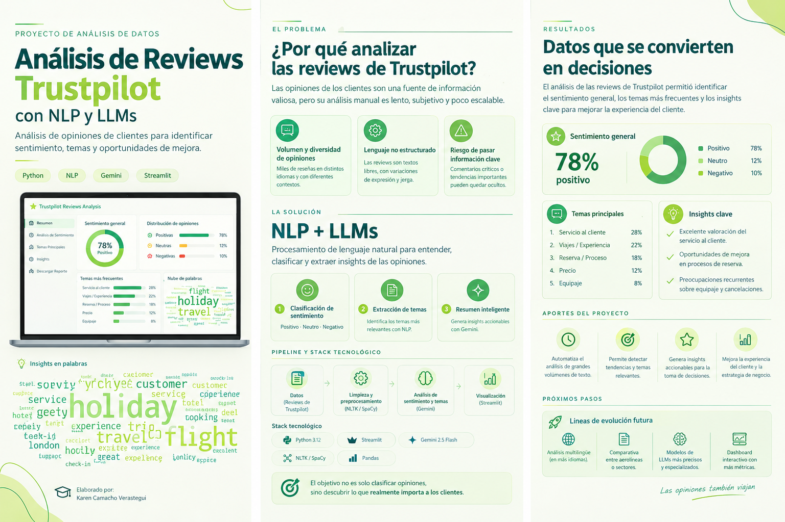

# Sobre mí

Soy Karen, Data Scientist especializada en soluciones analíticas, modelos predictivos y sistemas inteligentes aplicados a negocio.  
Transformo datos históricos en decisiones estratégicas y herramientas operativas que generan impacto real.

---

# Proyectos destacados

## Beauty Girl Studio – Smart Data Suite
Plataforma analítica para la fidelización y retención de clientas en centros de estética.

Incluye:
- Predicción del riesgo de no retorno a 90 días  
- Segmentación de clientas  
- Priorización operativa mediante dashboard  
- Integración de métricas de negocio reales  
- Arquitectura modular y escalable  

**Tecnologías:** Python · Pandas · NumPy · SQLite · Apache Parquet (pyarrow) · Scikit-learn 1.5.x (fijado por compatibilidad con CalibratedClassifierCV(cv="prefit") · SHAP · SciPy · Matplotlib · Seaborn · Plotly · Streamlit · Git · GitHub · python-dotenv (.env) · joblib (persistencia de modelo)

[Ver repositorio](https://github.com/Karen-JCV/Beauty-Girl-Studio-Smart-Data-Suite)

---

## AI Asistente de Extranjería (RAG + Gemini + LangGraph)
Asistente inteligente con recuperación semántica, memoria conversacional y procesamiento de documentos.

Incluye:
- RAG con ChromaDB  
- Memoria conversacional  
- Procesamiento de voz  
- Streaming token a token  
- Interfaz en Streamlit  

**Tecnologías:** Python · Gemini 2.5 Flash · LangChain · LangGraph · Google Generative AI Embeddings · ChromaDB · Streamlit · Google Gemini (SDK google-genai) · pypdf / python-docx

[Ver repositorio](https://github.com/Karen-JCV/AI-Asistente-de-Extranjeria)

---

## Análisis de Reviews Trustpilot con NLP
Análisis de sentimiento y extracción de insights a partir de reseñas reales.

Incluye:
- Limpieza y procesamiento de texto  
- Modelos de sentimiento  
- Visualización de resultados  

**Tecnologías:** Python · Scikit-learn · Pandas · NumPy · Matplotlib · Seaborn · Transformers · Hugging Face · BERTopic · UMAP · HDBSCAN

[Ver repositorio](https://github.com/Karen-JCV/Analisis-de-Reviews-Trustpilot-con-NLP-Canadian-Affair)

---

# Contacto

- **LinkedIn:** https://www.linkedin.com/in/karen-camacho-verastegui 
- **Email:** karen.verastegui22@outlook.com  
- **GitHub:** https://github.com/Karen-JCV  

# CV

[Descargar CV](assets/cv/KarenCamachoCV.pdf)

